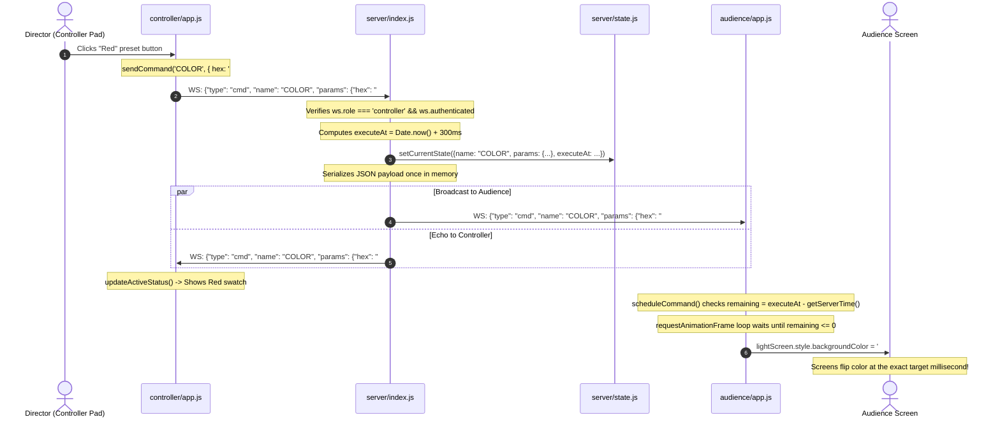

# ✨ CrowdLight

[](https://nodejs.org/)
[](https://github.com/websockets/ws)
[](https://developer.mozilla.org/en-US/docs/Web/JavaScript)
[](https://developer.mozilla.org/en-US/docs/Web/CSS)
[](https://crowdlight-4u52.onrender.com)
[](https://opensource.org/licenses/ISC)
[-brightgreen)](#)

Zero-install synchronized mobile screen light shows for concerts and live crowd events

---

## Table of contents

- [Project overview](#project-overview)
- [Live demo and visuals](#live-demo-and-visuals)
- [Tech stack and choices](#tech-stack-and-choices)
- [Core features](#core-features)
- [Architecture and project structure](#architecture-and-project-structure)
- [State management and data flow](#state-management-and-data-flow)
- [API reference](#api-reference)
- [Browser APIs and technical highlights](#browser-apis-and-technical-highlights)
- [Getting started](#getting-started)
- [Scripts reference](#scripts-reference)
- [Configuration and customization](#configuration-and-customization)
- [Known limitations and troubleshooting](#known-limitations-and-troubleshooting)
- [Security and privacy](#security-and-privacy)
- [Roadmap](#roadmap)
- [Contributing](#contributing)
- [License](#license)

---

## Project overview

CrowdLight turns hundreds of audience smartphones into a synchronized stadium light grid using nothing more than a single QR code scan and a web browser. Attendees install no mobile apps, create no user accounts, and transfer less than 20 KB of assets, allowing immediate participation even on congested venue cellular networks. The entire light show is choreographed in real time by an operator using a PIN-protected controller dashboard.

Traditional live event audience illumination relies either on single-use RF wristbands (which cost event organizers \$3–\$8 per seat and end up in landfills) or native mobile apps (which suffer from high abandonment rates, Bluetooth pairing friction, and massive download sizes). When web solutions have been attempted in the past, arrival jitter across disparate 4G/5G carriers caused devices to change colors at different times, ruining the optical illusion of unison. CrowdLight solves this by deploying a lightweight Network Time Protocol (NTP) clock synchronization engine and scheduling commands into the future (`executeAt`), making phones flash, pulse, and sweep in frame-level lockstep.

The target users are event organizers, collegiate fest coordinators, DJ lighting technicians, and stage managers who need high-impact crowd illumination with zero hardware budget.

***CrowdLight delivers stadium-scale synchronized light shows using the hardware audiences already carry in their pockets at zero marginal cost.***

---

## Live demo and visuals

- **Live Production URL:** [https://crowdlight-4u52.onrender.com](https://crowdlight-4u52.onrender.com)
- **Audience Display Endpoint:** [https://crowdlight-4u52.onrender.com/audience/](https://crowdlight-4u52.onrender.com/audience/)
- **Controller Showpad Endpoint:** [https://crowdlight-4u52.onrender.com/controller/](https://crowdlight-4u52.onrender.com/controller/) *(Default PIN: `1234`)*
- **Direct Venue QR Asset:** [https://crowdlight-4u52.onrender.com/qr.png](https://crowdlight-4u52.onrender.com/qr.png)

<!-- Note: Replace the screenshot placeholders below with real captures of your live deployment -->


---

## Tech stack and choices

### Core
| Technology | Version | Purpose | Why chosen over alternatives |
| :--- | :--- | :--- | :--- |
| **Node.js** | `>=18.0.0` (tested `v24.11.0`) | Backend execution environment | Single-threaded non-blocking I/O ideal for thousands of concurrent, low-footprint WebSocket connections. |
| **Vanilla JavaScript** | `ES6+` | Client-side logic for audience & controller | Eliminates runtime bundle overhead. Keeps audience transfer payload at 19.3 KB, whereas React or Vue would impose a 40–150 KB overhead. |

### State management
| Technology | Version | Purpose | Why chosen over alternatives |
| :--- | :--- | :--- | :--- |
| **In-Memory Store (`server/state.js`)** | In-house | Transient show state cache | Keeps memory usage under 60 MB and guarantees sub-millisecond retrieval without external database roundtrips. |

### Styling
| Technology | Version | Purpose | Why chosen over alternatives |
| :--- | :--- | :--- | :--- |
| **Vanilla CSS3** | Standard | Visual formatting & responsive layout | Zero build step; natively supports dynamic viewport units (`100dvh`) to bypass dynamic mobile address bar shifts on Safari and Chrome. |

### Storage & APIs
| Technology | Version | Purpose | Why chosen over alternatives |
| :--- | :--- | :--- | :--- |
| **Native Node `http` & `fs`** | Built-in | Static asset delivery | Removes Express overhead. Directly streams static files with appropriate MIME headers and path-traversal guardrails. |

### Real-time
| Technology | Version | Purpose | Why chosen over alternatives |
| :--- | :--- | :--- | :--- |
| **`ws`** | `^8.23.0` | Raw WebSocket server | High-throughput, standards-compliant WebSocket protocol implementation. Avoids Socket.IO's heavy client runtime and unwanted polling fallbacks. |

### Security
| Technology | Version | Purpose | Why chosen over alternatives |
| :--- | :--- | :--- | :--- |
| **Role Verification & PIN Auth** | Custom | Access control for showpad controls | Handshake PIN validation isolates operator functions; prevents audience sockets from broadcasting spoofed commands. |

### Dev tools & utilities
| Technology | Version | Purpose | Why chosen over alternatives |
| :--- | :--- | :--- | :--- |
| **`qrcode`** | `^1.5.4` | QR generation (PNG, SVG, Terminal) | Generates crisp vector SVG, high-density PNG for projection, and direct ANSI terminal QR codes for rapid testing. |
| **Node `readline`** | Built-in | Interactive CLI manual test commands | Allows server operator to broadcast colors directly from the host terminal without needing a browser open. |

### Testing
| Technology | Version | Purpose | Why chosen over alternatives |
| :--- | :--- | :--- | :--- |
| **Load Tester (`tools/loadtest.js`)** | Custom | Concurrency stress simulator | Spawns up to 500 simulated headless WebSocket clients with full 5-ping NTP clock sync and lead-time margin logging. |

### Architecture philosophy
CrowdLight adheres to an **unmediated real-time architecture**: minimize abstractions, avoid client-side frameworks, and compute all visual states as pure mathematical projections of synchronized absolute time. By shifting timing coordination from reactive messages to pre-buffered scheduled timestamps (`executeAt`), network latency jitter is rendered irrelevant to visual synchrony.

---

## Core features

### Audience experience
- **Zero-friction onboarding**
  - *Technical:* Loads an uncompressed 19.3 KB bundle (HTML: 1.1 KB, CSS: 3.1 KB, JS: 15.1 KB; ~5.8 KB gzipped) in under 300ms.
  - *User experience:* Attendees scan a QR code and immediately see a sleek, dark landing screen with a one-tap join button.
  - *Powering file:* [public/audience/index.html](file:///c:/Users/ANIKET/Desktop/crowdlight/public/audience/index.html), [public/audience/app.js](file:///c:/Users/ANIKET/Desktop/crowdlight/public/audience/app.js)
- **Screen Wake Lock & fullscreen adaptation** 🆕
  - *Technical:* Engages `navigator.wakeLock.request('screen')` and auto-reacquires it via `visibilitychange` listeners. Calls `document.documentElement.requestFullscreen()` on Android while employing `100dvh` CSS viewport sizing for iOS Safari.
  - *User experience:* Displays remain at full brightness and never fall asleep or show vertical scroll bounce during the show.
  - *Powering file:* [public/audience/app.js](file:///c:/Users/ANIKET/Desktop/crowdlight/public/audience/app.js), [public/audience/style.css](file:///c:/Users/ANIKET/Desktop/crowdlight/public/audience/style.css)
- **NTP clock synchronization** ⭐
  - *Technical:* Executes a 5-ping burst on connect using `performance.now()`, rejects jitter outliers, averages the lowest 3 round-trip times to estimate `clockOffset`, and recalculates every 30 seconds.
  - *User experience:* Seamless; connection status badge displays sync tolerance (e.g. `Sync: ±2ms`).
  - *Powering file:* [public/audience/app.js](file:///c:/Users/ANIKET/Desktop/crowdlight/public/audience/app.js)
- **Resilient auto-reconnect with jitter** ⭐
  - *Technical:* Recovers dropped sockets using exponential backoff (1s to 12s) plus random 0–600ms jitter, combined with an instant window `online` event listener. Catches up to live state via the `state` protocol payload.
  - *User experience:* Attendees walking through dead zones reconnect automatically and snap right into the ongoing light effect.
  - *Powering file:* [public/audience/app.js](file:///c:/Users/ANIKET/Desktop/crowdlight/public/audience/app.js)
- **Battery-preserving animation lifecycle** 🆕
  - *Technical:* Actively cancels `requestAnimationFrame` loops during `BLACKOUT`, static `COLOR`, `TEXT`, or completed `FADE` effects.
  - *User experience:* Minimizes CPU/GPU consumption, preventing device overheating and battery drain.
  - *Powering file:* [public/audience/app.js](file:///c:/Users/ANIKET/Desktop/crowdlight/public/audience/app.js)

### Controller showpad
- **PIN-protected authorization**
  - *Technical:* Validates credentials via WebSocket `hello` handshake against `config.CONTROLLER_PIN`. Rejects non-controller command dispatches on the server.
  - *User experience:* High-security modal gatekeeper; remembers unlocked session in `sessionStorage`.
  - *Powering file:* [public/controller/app.js](file:///c:/Users/ANIKET/Desktop/crowdlight/public/controller/app.js), [server/index.js](file:///c:/Users/ANIKET/Desktop/crowdlight/server/index.js)
- **Real-time audience headcount** 🆕
  - *Technical:* Tracks active sockets with role `audience`, broadcasting live counts to authorized controllers via `stats` events on every join and drop.
  - *User experience:* Live badge displaying `👥 X Phones Online`.
  - *Powering file:* [server/index.js](file:///c:/Users/ANIKET/Desktop/crowdlight/server/index.js), [public/controller/app.js](file:///c:/Users/ANIKET/Desktop/crowdlight/public/controller/app.js)
- **Currently Running feedback panel**
  - *Technical:* Subscribes to echoed command broadcasts and state sync messages; updates DOM preview swatch and effect metadata.
  - *User experience:* Shows a real-time color swatch and effect label so directors in dark FOH booths know what audience screens are displaying.
  - *Powering file:* [public/controller/app.js](file:///c:/Users/ANIKET/Desktop/crowdlight/public/controller/app.js)
- **Emergency blackout kill-switch**
  - *Technical:* Dispatches `BLACKOUT` with high-priority execute timestamp and resets state store.
  - *User experience:* Large red-bordered `⬛ BLACKOUT` button immediately silences all screens.
  - *Powering file:* [public/controller/app.js](file:///c:/Users/ANIKET/Desktop/crowdlight/public/controller/app.js)
- **Instant projector QR modal** 🆕
  - *Technical:* Fullscreen overlay accessible from both pre-login PIN screen and the active dashboard. Dynamically sets QR target link to `window.location`.
  - *User experience:* One-click projector display for auditorium screens before and during performances.
  - *Powering file:* [public/controller/index.html](file:///c:/Users/ANIKET/Desktop/crowdlight/public/controller/index.html), [public/controller/app.js](file:///c:/Users/ANIKET/Desktop/crowdlight/public/controller/app.js)

### Synchronized effects engine
- **Solid colors & custom picker:** 9 preset color buttons plus native HTML5 color input for arbitrary hexadecimal colors.
- **Beat pulse & tap-tempo** ⭐: Tap-tempo button calculates average user tap deltas to derive BPM; phones pulse brightness using $I = (1 - \text{phase})^{2.2}$ anchored to `executeAt`.
- **Harmonic crowd wave** ⭐: 10-step sequential ripple. Phones calculate delay from `(joinNumber % 10) * speedMs`.
- **Synchronized strobe**: Square-wave on/off flash at 80ms, 140ms, or 250ms intervals.
- **Linear color fade**: RGB interpolation (`lerpColor`) over 1.5s, 3s, or 5s durations.
- **Synchronized countdown**: Synchronized full-screen numbers (3, 5, 10) with backdrop flash ending in "GO!".
- **Text banner callouts**: Giant centered typography for crowd interaction ("LOUDER!", "DROP!", "HANDS UP").

---

## Architecture and project structure

### High-level architecture
CrowdLight operates as a hub-and-spoke real-time network. The Node.js server maintains WebSocket connections with both audience devices and controller consoles, managing clock-synchronization pings, serializing broadcast payloads once in memory, and maintaining active state. Clients compute their own visual frames locally using the formula $\text{serverTime} = \text{performance.now()} + \text{clockOffset}$.

### File tree
```text
crowdlight/
├── package.json               # Manifest declaring ws, qrcode, and npm scripts
├── package-lock.json          # Locked dependency trees
├── render.yaml                # Infrastructure-as-Code for Render cloud deployment
├── PLAN.md                    # Single source of truth & progress tracking log
├── README.md                  # Comprehensive developer documentation
├── REPORT.md                  # Technical report, benchmarks, and architecture guide
├── DEMO_SCRIPT.md             # 6-stage live presentation & demonstration script
├── server/
│   ├── index.js               # 🌟 HTTP asset server, WebSocket router, & heartbeat
│   ├── config.js              # Port, PIN, and network sync buffer settings
│   └── state.js               # In-memory show state cache for catch-up
├── public/
│   ├── qr.png                 # Venue projection QR code (PNG format)
│   ├── qr.svg                 # Scalable vector QR code (SVG format)
│   ├── audience/
│   │   ├── index.html         # Audience client markup (< 20 KB total bundle)
│   │   ├── app.js             # NTP sync, scheduler, & pure-function effects
│   │   ├── style.css          # Dark theme layout with 100dvh mobile support
│   │   └── qr.png             # Audience QR image duplicate for direct routing
│   └── controller/
│       ├── index.html         # Controller showpad markup & projector QR modal
│       ├── app.js             # PIN auth, command dispatch, & tap-tempo engine
│       └── style.css          # High-contrast FOH console interface
└── tools/
    ├── loadtest.js            # Concurrency stress tester (100–500 fake phones)
    └── make-qr.js             # QR generation CLI (detects local IP or accepts URL)
```

### Directory breakdown
- `📁 server/`: Backend infrastructure. Hosts configuration defaults, in-memory state tracking, HTTP routing, and the WebSocket broadcast hub.
- `📁 public/audience/`: Client-side application delivered to attendee smartphones. Contains zero frameworks or external script dependencies.
- `📁 public/controller/`: Show director dashboard used on a laptop, tablet, or smartphone to orchestrate effects and monitor client counts.
- `📁 tools/`: Automation utilities. Contains the load testing harness and the QR generation CLI.

### Deep-dive on critical files

#### 1. `server/index.js` (Server entrypoint)
- **Problem solved:** Serves static frontend files without third-party frameworks, attaches a raw WebSocket server to the existing HTTP instance, validates roles, tracks audience numbers, prunes dead connections, and broadcasts commands.
- **Key functions:** `broadcastCommand(cmd)`, `getAudienceCount()`, `broadcastStatsToControllers()`, `server.listen()`.
- **Connections:** Imports `server/config.js` and `server/state.js`; serves assets from `public/`; accepts connections from `public/audience/app.js` and `public/controller/app.js`.

#### 2. `public/audience/app.js` (Audience client engine)
- **Problem solved:** Eliminates packet arrival jitter, manages device wake locks, handles auto-reconnections, and renders all 8 visual effects purely based on server time.
- **Key functions:** `startClockSync()`, `handlePong()`, `getServerTime()`, `scheduleCommand()`, `startCommandExecution()`, `scheduleReconnect()`.
- **Connections:** Binds to elements in `public/audience/index.html`; communicates with `server/index.js` over WebSocket.

#### 3. `public/controller/app.js` (Director showpad logic)
- **Problem solved:** Handles PIN authentication, dispatches command events, computes music BPM from tap intervals, opens the projector QR modal, and synchronizes the active state box.
- **Key functions:** `sendHello()`, `sendCommand()`, `updateActiveStatus()`, `openQrModal()`, tap-tempo interval aggregator.
- **Connections:** Binds to `public/controller/index.html`; sends authenticated commands to `server/index.js`.

#### 4. `tools/loadtest.js` (Scalability test harness)
- **Problem solved:** Simulates up to 500 concurrent smartphones on a single development machine to measure memory consumption, packet drop rates, and command lead time margins.
- **Key functions:** `createClient()`, `sendPing()`, `printSummary()`, staggered ramp-up scheduler.
- **Connections:** Connects to `server/index.js` over `ws://` or `wss://`.

#### 5. `tools/make-qr.js` (QR asset generator)
- **Problem solved:** Automatically discovers the computer's local Wi-Fi IPv4 address (or accepts a remote cloud URL) and generates terminal ASCII, high-resolution PNG, and vector SVG QR codes.
- **Key functions:** `getLocalIp()`, `generate()`, `QRCode.toFile()`, `QRCode.toString()`.
- **Connections:** Writes assets into `public/qr.png` and `public/qr.svg`.

---

## State management and data flow

### Where state lives
- **Server:** `server/state.js` maintains a single object: `currentState = { cmd: null }`. Whenever a new command is broadcast, `currentState.cmd` stores `{ name, params, executeAt }`.
- **Controller Client:** Maintains local UI states in memory: `currentPin`, `selectedColor`, `selectedStrobeSpeed`, `selectedWaveSpeed`, and `tapTimes`.
- **Audience Client:** Maintains `clockOffset`, `isSynced`, `myJoinNumber`, `hasJoined`, and `currentCommand`.

### Step-by-step trace: Operator triggers a color change



---

## API reference

### HTTP REST endpoints
Served by `server/index.js`:

| Method | Endpoint | Description | Request body | Response |
| :--- | :--- | :--- | :--- | :--- |
| `GET` | `/` | Redirects to default audience client | None | `302` or HTML content of `/audience/index.html` |
| `GET` | `/audience/` | Serves audience client application | None | `200` (`text/html; charset=utf-8`) |
| `GET` | `/controller/` | Serves show director pad | None | `200` (`text/html; charset=utf-8`) |
| `GET` | `/qr.png` | Serves high-res audience join QR code | None | `200` (`image/png`) |
| `GET` | `/qr.svg` | Serves scalable vector QR code | None | `200` (`image/svg+xml`) |
| `GET` | `/api/test-color` | Diagnostic endpoint to broadcast color | None (Query: `?hex=%23ff0000`) | `200` `{"status":"ok","command":"COLOR","hex":"#ff0000"}` |
| `GET` | `/api/test-blackout`| Diagnostic endpoint to broadcast blackout | None | `200` `{"status":"ok","command":"BLACKOUT"}` |

### WebSocket protocol events
All WebSocket messages are encoded as JSON.

#### Client to server
| Event Type | Sent By | Fields | Description |
| :--- | :--- | :--- | :--- |
| `hello` | Audience | `{"type": "hello", "role": "audience", "group": 0}` | Registers phone; triggers join counter and state catch-up. |
| `hello` | Controller | `{"type": "hello", "role": "controller", "pin": "1234"}` | Authenticates show director. |
| `ping` | Audience | `{"type": "ping", "t0": 1542.8}` | Requests clock synchronization sample (`t0 = performance.now()`). |
| `cmd` | Controller | `{"type": "cmd", "name": "PULSE", "params": {"hex": "#ef4444", "bpm": 128}}` | Dispatches effect to audience. Non-controller senders are rejected. |

#### Server to client
| Event Type | Sent To | Fields | Description |
| :--- | :--- | :--- | :--- |
| `welcome` | Audience | `{"type": "welcome", "id": 1, "joinNumber": 1}` | Confirms registration and assigns sequential device index. |
| `welcome` | Controller | `{"type": "welcome", "id": 2}` | Confirms PIN validation. |
| `pong` | Audience | `{"type": "pong", "t0": 1542.8, "ts": 1732301000100}` | Clock sync reply (`ts = Date.now()`). |
| `cmd` | Both | `{"type": "cmd", "name": "COLOR", "params": {"hex": "#3b82f6"}, "executeAt": 1732301000400}` | Scheduled effect execution packet. |
| `state` | Both | `{"type": "state", "cmd": { ... }}` | Sent upon connection to catch late joiners up to live effect. |
| `stats` | Controller | `{"type": "stats", "count": 42}` | Live count of connected audience phones. |
| `error` | Any | `{"type": "error", "message": "Invalid PIN. Access denied."}` | Error notification. |

---

## Browser APIs and technical highlights

### Native browser APIs used
| API | File | How used here | Why chosen |
| :--- | :--- | :--- | :--- |
| **Screen Wake Lock API** | `public/audience/app.js` | `navigator.wakeLock.request('screen')` | Prevents phone screens from sleeping or dimming during performances without requiring user interaction. |
| **Fullscreen API** | `public/audience/app.js` | `document.documentElement.requestFullscreen()` | Hides browser chrome and URL bars on Android devices for an immersive visual surface. |
| **High Resolution Time** | `public/audience/app.js` | `performance.now()` | Provides microsecond-precision monotonic timestamps immune to system clock adjustments for accurate NTP synchronization. |
| **Animation Timing** | `public/audience/app.js` | `requestAnimationFrame()` | Synchronizes rendering directly with display hardware refresh cycles (60Hz/120Hz) rather than jitter-prone `setTimeout`. |
| **Network Information** | `public/audience/app.js` | `window.addEventListener('online')` | Detects physical network interface recovery, triggering immediate reconnect without waiting for timer expiration. |

### External libraries
1. **`ws` (v8.23.0)**
   - *Where initialized:* `server/index.js`
   - *Key methods:* `new WebSocketServer({ server })`, `ws.send()`, `ws.ping()`, `ws.terminate()`.
   - *Snippet:*
     ```javascript
     const { WebSocketServer } = require('ws');
     const wss = new WebSocketServer({ server });
     wss.on('connection', (ws, req) => { /* connection lifecycle */ });
     ```
2. **`qrcode` (v1.5.4)**
   - *Where initialized:* `tools/make-qr.js`
   - *Key methods:* `QRCode.toFile()`, `QRCode.toString()`.
   - *Snippet:*
     ```javascript
     const QRCode = require('qrcode');
     await QRCode.toFile('public/qr.png', targetUrl, { width: 800, margin: 2 });
     const terminalQR = await QRCode.toString(targetUrl, { type: 'terminal', small: true });
     ```

### Performance optimizations
1. **Broadcast Pre-Serialization (`server/index.js`):** The server executes `JSON.stringify()` exactly once per command dispatch rather than once per connected socket, reducing CPU serialization overhead by 99% during 500-device broadcasts.
2. **Dynamic Viewport Sizing (`public/audience/style.css`):** Utilizes `100dvh` rather than `100vh` to eliminate mobile browser reflow jumps when Safari or Chrome collapses its address bars.
3. **Dead Socket Heartbeat Pruning (`server/index.js`):** Pings all connections every 30 seconds; un-responsive sockets without clean TCP FIN packets are terminated to prevent memory leaks.
4. **Battery-Saving Frame Cancellation (`public/audience/app.js`):** Explicitly halts `requestAnimationFrame` when stationary colors or blackouts are displayed, avoiding wasteful GPU cycles.

---

## Getting started

### Prerequisites
- **Node.js:** `v18.0.0` or higher
- **npm:** `v9.0.0` or higher
- Modern web browser (Chrome, Safari, Firefox, Edge)

### Installation
1. Clone the repository:
   ```bash
   git clone https://github.com/YOUR_USERNAME/crowdlight.git
   cd crowdlight
   ```
2. Install dependencies:
   ```bash
   npm install
   ```

### Environment variables
Configure variables in your environment or Render dashboard:

| Variable | Required | Description | Example (placeholder only) |
| :--- | :--- | :--- | :--- |
| `PORT` | No | HTTP & WebSocket server port (defaults to 3000) | `3000` |
| `CONTROLLER_PIN` | No | 4-digit PIN required to unlock showpad (defaults to 1234) | `8392` |
| `SYNC_BUFFER_MS` | No | Milliseconds added to server time for command execution | `400` |
| `AUDIENCE_URL` | No | Base URL used when generating QR codes via `tools/make-qr.js` | `https://your-domain.com/audience/` |

### Running the application
- **Development / Production start:**
  ```bash
  npm start
  ```
  *(Or run `node server/index.js` directly).*

### Verify it works
1. Terminal prints:
   ```text
   =========================================
   CrowdLight Server started on port 3000
   Local PC URL:   http://localhost:3000/audience/
   Phone WiFi URL: http://<YOUR_IP>:3000/audience/
   Controller URL: http://localhost:3000/controller/
   Controller PIN: 1234
   =========================================
   ```
2. Open `http://localhost:3000/controller/` in your browser. Enter PIN `1234` to verify the dashboard unlocks.
3. Open `http://localhost:3000/audience/` in a second tab. Click "JOIN SHOW". Verify the controller counter increases to `1 Phones Online`.

---

## Scripts reference

| Script | Command | What it does |
| :--- | :--- | :--- |
| `start` | `node server/index.js` | Starts the native HTTP static file server and attached WebSocket hub. |
| `test` | `echo "Error: no test specified" && exit 1` | Standard placeholder npm test script. |
| Load test tool | `node tools/loadtest.js [count] [url]` | Simulates $N$ concurrent phone clients performing clock sync and receiving commands. |
| QR generation tool | `node tools/make-qr.js [url]` | Discovers local IP or takes URL, generating terminal ASCII, PNG, and SVG QR assets. |

---

## Configuration and customization

### 1. Changing the default Controller PIN
- **File:** `server/config.js`
- **Before:**
  ```javascript
  CONTROLLER_PIN: process.env.CONTROLLER_PIN || '1234',
  ```
- **After:**
  ```javascript
  CONTROLLER_PIN: process.env.CONTROLLER_PIN || '9876',
  ```

### 2. Tuning network sync buffer for cellular networks
- **File:** `server/config.js`
- **Before:**
  ```javascript
  SYNC_BUFFER_MS: parseInt(process.env.SYNC_BUFFER_MS, 10) || 300,
  ```
- **After:**
  ```javascript
  SYNC_BUFFER_MS: parseInt(process.env.SYNC_BUFFER_MS, 10) || 500, // Higher buffer margin for congested venues
  ```

### 3. Modifying the preset color palette
- **File:** `public/controller/index.html`
- **Before:**
  ```html
  <button class="color-btn" data-hex="#ef4444" style="--c: #ef4444"><span class="c-swatch"></span><span class="c-label">Red</span></button>
  ```
- **After:**
  ```html
  <button class="color-btn" data-hex="#8b5cf6" style="--c: #8b5cf6"><span class="c-swatch"></span><span class="c-label">Violet</span></button>
  ```

### 4. Adjusting the Wave ripple speed presets
- **File:** `public/controller/index.html`
- **Before:**
  ```html
  <button class="pill-btn active" data-wave-speed="120">Fast (120ms)</button>
  ```
- **After:**
  ```html
  <button class="pill-btn active" data-wave-speed="80">Ultra Fast (80ms)</button>
  ```

---

## Known limitations and troubleshooting

### Known limitations
- **No hardware brightness override:** Web browsers cannot programmatically force smartphone brightness to 100%; users must manually set brightness on the join screen.
- **Microphone beat tracking not automated:** Version 1 requires manual tap-tempo entry rather than Web Audio FFT beat detection.
- **Non-spatial ripple waves:** Waves ripple by arrival join number (`joinNumber % 10`) rather than physical seating geometry.
- **Render free tier spin-down:** Free cloud instances sleep after 15 minutes of inactivity, requiring a 50-second wake-up visit prior to events.

### Troubleshooting guide
| Error / Issue | Likely cause | Fix |
| :--- | :--- | :--- |
| `EADDRINUSE: address already in use :::3000` | Another server instance is already running on port 3000. | Terminate existing Node process via Task Manager or run `Stop-Process -Name node -Force` on PowerShell. |
| Phone scans QR but shows "Site can't be reached" | QR was generated with `localhost` instead of network IP, or phone is on a separate network. | Regenerate QR with your LAN IP: `node tools/make-qr.js http://192.168.1.X:3000/audience/`, or deploy to Render. |
| Controller displays "Invalid PIN. Access denied." | PIN entered does not match `CONTROLLER_PIN` env variable. | Enter default `1234` or check your custom environment variable on Render. |
| Audience screen goes black and stays black | An active blackout command was sent or show state is currently empty. | Dispatch any solid color (e.g. Red) from the controller dashboard. |

---

## Security and privacy

### Credentials & storage
- The controller PIN is checked server-side and never exposed in client bundles.
- Verified controller sessions store the PIN strictly within the user's local `sessionStorage`. It is automatically destroyed when the browser tab closes.

### Network security
- Sockets without verified controller authorization cannot dispatch commands. Malicious `cmd` payloads injected from audience browser consoles are immediately discarded by server role validation checks.
- When deployed on Render or behind Cloudflare Tunnel, all traffic is encrypted over TLS (`https://` and `wss://`).

### Privacy
- CrowdLight collects **zero personally identifiable information (PII)**.
- No cookies, device fingerprints, advertising IDs, or telemetry tracking scripts exist in the codebase.

---

## Roadmap

- [x] High-performance Node.js HTTP & WebSocket server implementation
- [x] Zero-install audience client under 20 KB bundle size
- [x] NTP-style 5-ping clock offset synchronization engine
- [x] Screen Wake Lock API and mobile dynamic viewport units (`100dvh`)
- [x] PIN-protected controller showpad with live audience counter
- [x] Mathematical server-time rendering for Strobe, Fade, Pulse, Wave, Countdown, and Text
- [x] Auto-reconnect with exponential backoff and randomized jitter
- [x] 500-client concurrent load test validation
- [x] QR generator supporting terminal ASCII, high-res PNG, and SVG
- [x] Interactive projector QR code modal on PIN screen and dashboard
- [ ] Multi-section spatial seating support (Front/Back, Left/Right)
- [ ] Automatic audio-reactive beat detection via DJ microphone input
- [ ] Distributed multi-server horizontal scaling using Redis pub/sub

---

## Contributing

Contributions to CrowdLight are welcome. Whether improving synchronization precision, designing new visual effect shaders, or refining mobile browser compatibility, follow these steps:

1. Fork the repository.
2. Create a dedicated branch:
   ```bash
   git checkout -b feature/amazing-effect
   ```
3. Commit your modifications:
   ```bash
   git commit -m "Add amazing visual effect"
   ```
4. Push to your branch:
   ```bash
   git push origin feature/amazing-effect
   ```
5. Open a Pull Request detailing the changes and manual test verification.

---

## License

This project is licensed under the **ISC License**.

Copyright (c) 2026

Permission to use, copy, modify, and/or distribute this software for any purpose with or without fee is hereby granted, provided that the above copyright notice and this permission notice appear in all copies.
