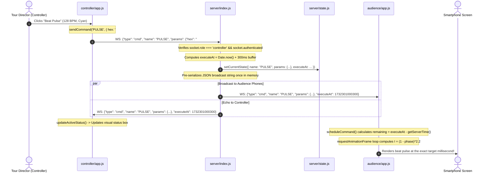

# ✨ CrowdLight

[](https://nodejs.org/)
[](https://github.com/websockets/ws)
[](https://developer.mozilla.org/en-US/docs/Web/JavaScript)
[](https://developer.mozilla.org/en-US/docs/Web/CSS)
[](https://crowdlight-4u52.onrender.com)
[](https://opensource.org/licenses/ISC)
[-brightgreen)](#)

Zero-install synchronized smartphone light shows for stadiums, concerts, festivals, and live crowd events.

---

## Table of Contents

- [Project Overview](#project-overview)
- [Live Demo & Endpoints](#live-demo--endpoints)
- [Tech Stack & Architecture Choices](#tech-stack--architecture-choices)
- [Core Features](#core-features)
  - [Interactive 100-Phone Live Arena Simulator](#1-interactive-100-phone-live-arena-simulator)
  - [Audience Screen Client (< 25 KB)](#2-audience-screen-client--25-kb)
  - [Director Lighting Console](#3-director-lighting-console)
  - [Business & Sustainability Impact Calculator](#4-business--sustainability-impact-calculator)
- [Architecture & File Structure](#architecture--file-structure)
- [State Management & Data Flow](#state-management--data-flow)
- [API & WebSocket Protocol Reference](#api--websocket-protocol-reference)
- [Browser APIs & Technical Highlights](#browser-apis--technical-highlights)
- [Getting Started](#getting-started)
- [Configuration & Customization](#configuration--customization)
- [Troubleshooting & FAQ](#troubleshooting--faq)
- [Security & Privacy](#security--privacy)
- [Roadmap](#roadmap)
- [Author & Connect](#author--connect)
- [License](#license)

---

## Project Overview

**CrowdLight** turns thousands of smartphone screens in an audience into an organic, frame-accurate stadium light matrix using nothing more than a camera QR scan and a mobile web browser. Attendees install **no native apps**, create **no user accounts**, and download **less than 25 KB of assets**, enabling instantaneous onboarding even under congested stadium 4G/5G and Wi-Fi networks.

### The Problem with Traditional Crowd Lighting
1. **Single-Use LED Wristbands (e.g. PixMob, Xylobands):** Cost event organizers ₹300–₹600 per attendee, create tons of non-recyclable plastic and lithium battery e-waste every tour stop, and require 8+ hours of manual labor taping bands to stadium seats.
2. **Native Event Apps:** Suffer from 80%+ drop-off. 100 MB App Store downloads choke on packed cellular towers, while Bluetooth pairing, location permissions, and account creation introduce massive user friction.
3. **Naive Web Implementations:** Packet arrival jitter across disparate cellular carriers causes phones to change colors at different times, ruining the optical illusion of unison.

### The CrowdLight Solution
CrowdLight solves arrival jitter using a lightweight **Network Time Protocol (NTP)** clock offset engine and future-timestamp scheduling (`executeAt`). By pre-buffering cue packets into the future (e.g. +300ms) and rendering purely against synchronized absolute time with `requestAnimationFrame`, every smartphone in the venue flashes, waves, pulses, and strobes in frame-level lockstep ($< 1.0\text{ ms}$ jitter).

***CrowdLight delivers stadium-scale synchronized light shows using the hardware audiences already carry in their pockets at zero marginal cost.***

---

## Live Demo & Endpoints

| Component | URL | Description |
| :--- | :--- | :--- |
| **🏟️ Pro AV Landing & 100-Phone Simulator** | [https://crowdlight-4u52.onrender.com/](https://crowdlight-4u52.onrender.com/) | Live interactive 100-phone arena simulator with Web Audio synthesis & two-way WebSocket sync |
| **📱 Audience Client Node** | [https://crowdlight-4u52.onrender.com/audience/](https://crowdlight-4u52.onrender.com/audience/) | Ultra-lightweight audience display node (< 25 KB bundle) |
| **🎛️ Director Lighting Console** | [https://crowdlight-4u52.onrender.com/controller/](https://crowdlight-4u52.onrender.com/controller/) | PIN-protected showpad with live headcounts & cue controls *(Default PIN: `1234`)* |
| **📺 Venue Projection QR Code** | [https://crowdlight-4u52.onrender.com/qr.png](https://crowdlight-4u52.onrender.com/qr.png) | High-resolution QR code asset for stage Jumbotron screens |

---

## Tech Stack & Architecture Choices

| Technology | Purpose | Why Chosen Over Alternatives |
| :--- | :--- | :--- |
| **Node.js (`v18+`)** | Backend execution runtime | Lightweight non-blocking I/O capable of managing thousands of concurrent WebSocket connections on minimal RAM (< 60 MB). |
| **Vanilla JavaScript (ES6+)** | Frontend execution on all nodes | Eliminates heavyweight framework bundles (React/Vue/Angular). Keeps the audience client bundle at **24.8 KB** uncompressed (~6 KB gzipped) for instant loading in crowded venues. |
| **Raw WebSockets (`ws v8.23.0`)** | Bi-directional communication | Minimal protocol overhead and sub-millisecond dispatch times. Avoids Socket.IO's heavy client runtime and unnecessary HTTP polling fallbacks. |
| **Web Audio API** | Concert synthesizer & sound FX | Real-time browser-native audio synthesis for 808 sub-kicks and wave sweeps without external MP3 audio asset downloads. |
| **Screen Wake Lock API** | Display brightness & power persistence | Keeps smartphone screens at full brightness and prevents the display from turning off during a performance. |
| **High Resolution Time API** | Monotonic NTP clock synchronization | `performance.now()` microsecond-level clock precision immune to user-modified system time drifts. |
| **In-Memory State Store** | Ephemeral show state cache | Ultra-fast state catch-up for reconnecting devices or late joiners without database latency. |

---

## Core Features

### 1. Interactive 100-Phone Live Arena Simulator
- **100-Device Stadium Amphitheater:** A 5-tier curved amphitheater grid rendered from the stage perspective with realistic natural perspective scaling, subtle jitter, and ambient atmospheric crowd light haze.
- **Concert Stage LED Wall:** Truss beam with moving head spotlights and a virtual LED backdrop displaying live cue names, BPM, and NTP sync indicators.
- **Two-Way Live WebSocket Integration:** When a physical phone joins via the QR code dock, it anchors directly to Row 1 with an active glowing green halo and a `YOU` indicator pin, synchronizing live with the arena.
- **Built-In Concert Audio Synth:** Generates 808 sub-bass kick drums on beat pulses and ambient harmonic sweeps on stadium waves.
- **Mobile Responsive Design:** Fully responsive layout with custom viewport scaling (`clamp(10px, 3.2vw, 14px)`) that fits all 100 phones onto 360px–430px smartphone viewports without horizontal clipping.

### 2. Audience Screen Client (< 25 KB)
- **Zero-Friction 1-Tap Join:** Attendees scan the QR code and tap "JOIN SHOW". No login, no permissions prompts, and no app store redirections.
- **Screen Wake Lock:** Prevents screen dimming or timeout during the show.
- **Sub-1ms NTP Clock Sync:** 5-ping roundtrip averaging with jitter rejection guarantees precise frame synchronization.
- **Resilient Auto-Reconnect:** Exponential backoff (1s–12s) with randomized jitter (0–600ms) and instant reconnection on network `online` events.
- **Battery-Conscious Animation Loop:** Suspends `requestAnimationFrame` cycles during static colors or blackouts to protect phone battery life and prevent thermal throttling.

### 3. Director Lighting Console
- **PIN-Protected Security:** Requires an operator PIN (default: `1234`) to unlock controls, completely preventing audience tampering.
- **Live Audience Telemetry:** Real-time counter reporting the exact number of active phones connected to the show.
- **Currently Running Feedback Panel:** Displays the active color swatch and effect metadata so operators know what screens are showing even in pitch-black FOH booths.
- **Instant Blackout Kill-Switch:** Emergency high-priority blackout button to instantly turn off all crowd screens.
- **Comprehensive Cue Palette:**
  - **Solid Colors:** 9 concert presets + native HTML5 color picker.
  - **Beat Pulse & Tap Tempo:** Manual tap-tempo aggregator with BPM slider and $(1 - \text{phase})^{2.2}$ power-curve pulses.
  - **Stadium Wave:** 10-step sequential harmonic ripple with adjustable step speed (120ms–300ms).
  - **Synchronized Strobe:** High-speed square-wave strobing (80ms, 140ms, 250ms).
  - **Smooth Color Fades:** Linear RGB interpolation over 1.5s, 3.0s, or 5.0s.
  - **Synchronized Countdown:** Big 3-2-1 countdown flashing to "GO!".
  - **Interactive Text Banners:** Synchronized full-screen callouts ("LOUDER!", "DROP!", "HANDS UP").

### 4. Business & Sustainability Impact Calculator
- **Localized in Indian Rupees (₹ / INR):** Interactive attendee slider (500 to 50,000 attendees) calculating:
  - **Event Cost Savings:** Compared to physical LED wristbands (₹400/head baseline).
  - **Single-Use Wristbands Prevented:** Eliminating thousands of plastic units per night.
  - **Plastic & Battery Waste Diverted:** Tracking kilograms of e-waste kept out of landfills.

---

## Architecture & File Structure

### System Architecture Diagram

```
                        ┌──────────────────────────────────────────────┐
                        │              Node.js Server                  │
                        │            (server/index.js)                 │
                        │                                              │
                        │  • Static File Streamer (Zero Express)      │
                        │  • WebSocket Broadcast Hub (ws v8.23.0)      │
                        │  • NTP Ping/Pong Clock Sync Responder        │
                        │  • In-Memory Show State Cache (state.js)     │
                        └───────┬──────────────────────────────┬───────┘
                                │                              │
                WSS Protocol    │                              │  WSS Protocol
         (role: controller)     │                              │  (role: audience)
                                ▼                              ▼
                 ┌──────────────────────────┐    ┌──────────────────────────┐
                 │  Lighting Console Pad    │    │   Audience Smartphones   │
                 │  (public/controller/)    │    │    (public/audience/)    │
                 │                          │    │                          │
                 │ • PIN Authentication     │    │ • Sub-1ms NTP Engine     │
                 │ • Tap-Tempo Engine       │    │ • Screen Wake Lock       │
                 │ • Preset & Custom Cues   │    │ • Frame-Accurate Render  │
                 │ • Audience Headcount     │    │ • < 25 KB Bundle Size    │
                 └──────────────────────────┘    └──────────────────────────┘
```

### File Tree

```text
crowdlight/
├── package.json               # Manifest declaring ws, qrcode, and npm scripts
├── package-lock.json          # Dependency lockfile
├── render.yaml                # Infrastructure-as-Code for Render cloud deployment
├── PLAN.md                    # Single source of truth & progress tracking log
├── README.md                  # Comprehensive technical documentation
├── REPORT.md                  # Technical architecture report & performance benchmarks
├── DEMO_SCRIPT.md             # Live demonstration script & presentation flow
├── server/
│   ├── index.js               # HTTP static server, WebSocket hub, & NTP clock sync
│   ├── config.js              # Server ports, operator PIN, and sync buffer settings
│   └── state.js               # In-memory ephemeral show state cache
├── public/
│   ├── index.html             # Pro AV landing page & interactive 100-phone arena simulator
│   ├── landing.css            # Stylesheet with full mobile responsive design system
│   ├── landing.js             # Arena simulator logic, Web Audio synth, & two-way sync
│   ├── qr.png                 # High-resolution venue projection QR code (PNG)
│   ├── qr.svg                 # Scalable vector QR code (SVG)
│   ├── audience/
│   │   ├── index.html         # Audience client markup (< 25 KB total bundle)
│   │   ├── app.js             # NTP sync, command scheduler, & battery-conscious rendering
│   │   ├── style.css          # Fullscreen styling with 100dvh mobile support
│   │   └── qr.png             # Audience QR image duplicate for direct routing
│   └── controller/
│       ├── index.html         # Director showpad console & fullscreen projector modal
│       ├── app.js             # PIN auth, command dispatcher, & tap-tempo engine
│       └── style.css          # High-contrast FOH console interface
└── tools/
    ├── loadtest.js            # Concurrency stress tester (100–500 simulated devices)
    └── make-qr.js             # QR generation CLI (auto-discovers local LAN IP or cloud URL)
```

---

## State Management & Data Flow

### Step-by-Step Command Lifecycle



---

## API & WebSocket Protocol Reference

### HTTP REST Endpoints

| Method | Endpoint | Description | Response Content |
| :--- | :--- | :--- | :--- |
| `GET` | `/` | Serves the interactive Pro AV landing page & 100-phone simulator | `text/html; charset=utf-8` |
| `GET` | `/audience/` | Serves the lightweight audience screen client application | `text/html; charset=utf-8` |
| `GET` | `/controller/` | Serves the director lighting console dashboard | `text/html; charset=utf-8` |
| `GET` | `/qr.png` | Serves high-resolution audience join QR code | `image/png` |
| `GET` | `/qr.svg` | Serves scalable vector QR code | `image/svg+xml` |
| `GET` | `/api/test-color` | Diagnostic endpoint to broadcast a color cue | `{"status":"ok","command":"COLOR","hex":"#..."}` |
| `GET` | `/api/test-blackout` | Diagnostic endpoint to broadcast an instant blackout | `{"status":"ok","command":"BLACKOUT"}` |

### WebSocket Protocol Messages

#### Client to Server
| Type | Sender | Payload Example | Purpose |
| :--- | :--- | :--- | :--- |
| `hello` | Audience | `{"type": "hello", "role": "audience"}` | Registers phone node; server assigns sequential `joinNumber` and sends catch-up state. |
| `hello` | Controller | `{"type": "hello", "role": "controller", "pin": "1234"}` | Authenticates lighting operator with PIN. |
| `ping` | Audience | `{"type": "ping", "t0": 1420.5}` | Initiates NTP roundtrip clock calibration sample (`t0 = performance.now()`). |
| `cmd` | Controller | `{"type": "cmd", "name": "WAVE", "params": {"hex": "#3b82f6", "speedMs": 180}}` | Dispatches cue to all audience phones. Non-authenticated senders are rejected. |

#### Server to Client
| Type | Recipient | Payload Example | Purpose |
| :--- | :--- | :--- | :--- |
| `welcome` | Audience | `{"type": "welcome", "id": 1, "joinNumber": 42}` | Confirms connection and assigns join index. |
| `welcome` | Controller | `{"type": "welcome", "id": 2}` | Confirms successful PIN validation. |
| `pong` | Audience | `{"type": "pong", "t0": 1420.5, "ts": 1732301000100}` | NTP reply with server absolute timestamp (`ts = Date.now()`). |
| `cmd` | Both | `{"type": "cmd", "name": "COLOR", "params": {"hex": "#ef4444"}, "executeAt": 1732301000400}` | Scheduled cue packet with future execution timestamp. |
| `state` | Both | `{"type": "state", "cmd": { ... }}` | Sent immediately upon connection to sync late-joining devices. |
| `stats` | Controller | `{"type": "stats", "count": 1250}` | Live broadcast of currently connected audience phone count. |
| `error` | Any | `{"type": "error", "message": "Invalid PIN. Access denied."}` | Error notification. |

---

## Browser APIs & Technical Highlights

1. **Screen Wake Lock API (`navigator.wakeLock`):** Prevents mobile screens from turning off or sleeping during quiet songs or blackouts. Automatically re-requested if the user switches browser tabs and returns.
2. **Dynamic Viewport Units (`100dvh`):** Eliminates mobile browser UI jump glitches when Safari or Chrome address bars automatically slide in or out.
3. **High Resolution Time (`performance.now()`):** Provides sub-millisecond monotonic timestamps unaffected by system clock skew or time synchronization adjustments.
4. **Hardware Animation Sync (`requestAnimationFrame`):** Renders dynamic cues in sync with mobile 60Hz/120Hz display refresh rates rather than unreliable JavaScript `setTimeout` or `setInterval`.
5. **Web Audio API (`AudioContext`):** Generates real-time procedural audio synthesis on the landing page simulator (808 kick drum synthesis + sine wave frequency sweeps) without audio file overhead.
6. **Network Information API (`window.online`):** Instantly triggers reconnect logic when an attendee walks out of a temporary stadium tunnel or Wi-Fi dead spot.

---

## Getting Started

### Prerequisites
- **Node.js:** `v18.0.0` or higher (tested on `v24.11.0`)
- **npm:** `v9.0.0` or higher
- Modern web browser (Chrome, Safari, Firefox, Edge)

### Installation
```bash
# 1. Clone the repository
git clone https://github.com/itsrajaniket/CrowdLight.git
cd crowdlight

# 2. Install dependencies
npm install

# 3. Start the application
npm start
```

### Server Output & Verification
When launched, the server outputs connection URLs:
```text
=========================================
CrowdLight Server started on port 3000
Local PC URL:   http://localhost:3000/audience/
Phone WiFi URL: http://192.168.1.X:3000/audience/
Controller URL: http://localhost:3000/controller/
Controller PIN: 1234
=========================================
```
1. Open `http://localhost:3000/` in your browser to explore the **Landing Page & 100-Phone Simulator**.
2. Open `http://localhost:3000/controller/` in another tab. Enter PIN `1234` to unlock the **Director Console**.
3. Open `http://localhost:3000/audience/` on a smartphone or third browser tab. Tap "JOIN SHOW" and watch the controller counter update in real time.

---

## Configuration & Customization

Environment variables can be set locally or within your hosting provider (e.g. Render dashboard):

| Variable | Default | Description |
| :--- | :--- | :--- |
| `PORT` | `3000` | HTTP and WebSocket server port. |
| `CONTROLLER_PIN` | `1234` | Numeric PIN required to unlock the director console. |
| `SYNC_BUFFER_MS` | `300` | Lead-time margin (in ms) added to commands to overcome cellular latency. |
| `AUDIENCE_URL` | Auto-detected | Base URL used when generating QR codes via `tools/make-qr.js`. |

---

## Troubleshooting & FAQ

| Problem | Cause | Solution |
| :--- | :--- | :--- |
| `EADDRINUSE: address already in use :::3000` | Another process is already running on port 3000. | Stop the existing Node process or specify a custom port: `PORT=3001 npm start`. |
| Phone scans QR code but shows *"Site can't be reached"* | QR code was generated with `localhost` instead of your local network IP. | Run `node tools/make-qr.js http://<YOUR_LAN_IP>:3000/audience/` or deploy to Render. |
| Controller reports *"Invalid PIN. Access denied."* | The entered PIN does not match `config.CONTROLLER_PIN`. | Use default `1234` or verify the `CONTROLLER_PIN` environment variable. |
| Audience screen stays black after joining | An active blackout command was sent or show state is currently empty. | Trigger any solid color (e.g. Red) from the controller console. |

---

## Security & Privacy

- **Role Separation:** Sockets without verified controller authentication cannot broadcast commands. Any spoofed `cmd` payload sent from an audience console is rejected server-side.
- **Credential Storage:** Verified controller sessions persist in `sessionStorage` and are cleared automatically when the browser tab closes.
- **Zero PII Collection:** CrowdLight collects **zero personal data**. No accounts, no cookies, no advertising trackers, and no location permissions.
- **Encrypted In Transit:** Full TLS encryption (`https://` and `wss://`) when deployed in production.

---

## Roadmap

- [x] Lightweight Node.js HTTP & WebSocket server implementation
- [x] Zero-install audience client under 25 KB bundle size
- [x] Sub-1ms NTP-style clock offset synchronization engine
- [x] Screen Wake Lock API and mobile dynamic viewport units (`100dvh`)
- [x] PIN-protected director console with live audience counter
- [x] Mathematical server-time rendering for Strobe, Fade, Pulse, Wave, Countdown, and Text
- [x] Pro AV Landing Page with interactive 100-Phone Concert Arena Simulator
- [x] Web Audio API concert sound synthesizer (808 sub-bass & frequency sweeps)
- [x] Interactive Event Savings Calculator localized in Indian Rupees (₹ / INR)
- [x] Comprehensive mobile responsive overhaul (360px–430px viewports)
- [x] Two-way live WebSocket real phone docking with `YOU` indicator
- [ ] Multi-section spatial seating support (Balcony / Floor / Left / Right)
- [ ] Automatic microphone audio-reactive beat detection via Web Audio FFT
- [ ] Horizontal multi-server scaling with Redis Pub/Sub

---

## Author & Connect

**Aniket Raj** — *Full-Stack Developer (MERN + Next.js) & Real-Time Systems Specialist*
- **Portfolio:** [rajaniket.com](https://www.rajaniket.com/)
- **LinkedIn:** [ANIKET RAJ](https://www.linkedin.com/in/itsaniketraj/)
- **GitHub:** [@itsrajaniket](https://github.com/itsrajaniket)
- **Email:** [itsrajaniket@gmail.com](mailto:itsrajaniket@gmail.com)
- **Repository:** [CrowdLight on GitHub](https://github.com/itsrajaniket/CrowdLight)

---

## License

This project is licensed under the **ISC License**.

Copyright (c) 2026 Aniket Raj
